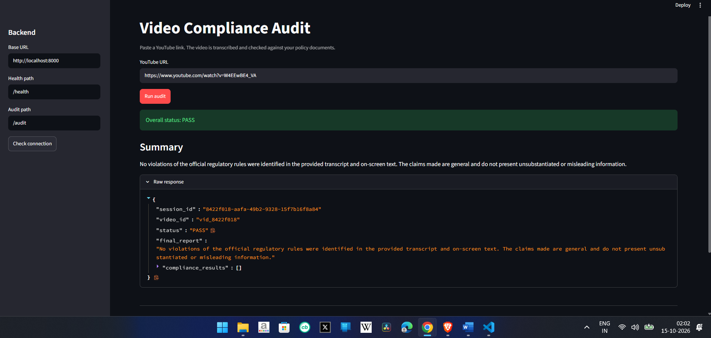
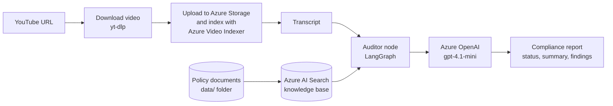
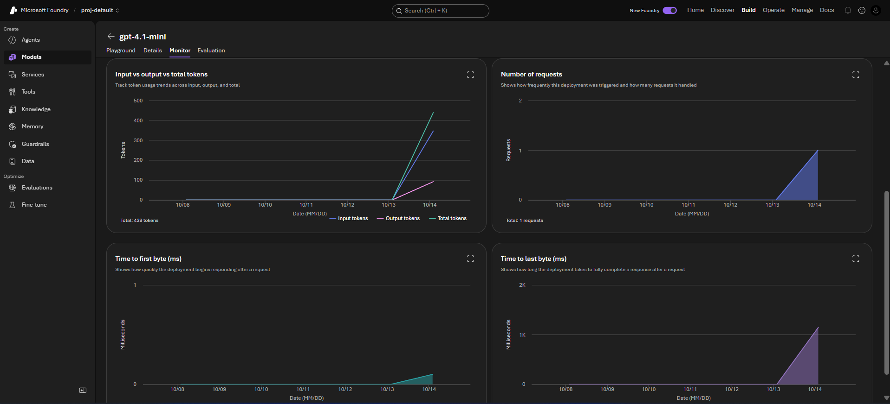
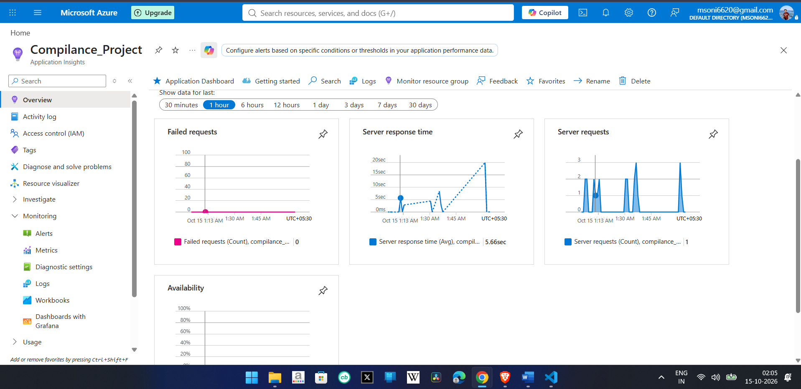
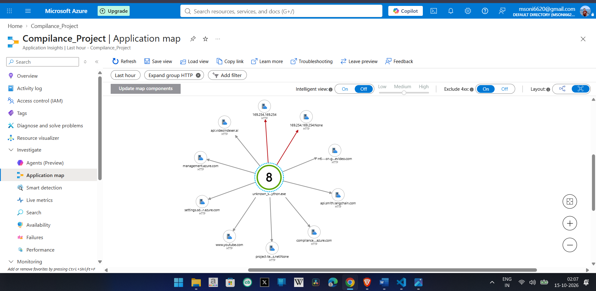

# Azure Multi-Modal Compliance Ingestion Engine (LangGraph)

An AI-powered compliance auditing pipeline. Give it a **YouTube video URL**, and it downloads the video, generates a transcript, checks the content against **policy documents** stored in a knowledge base, and returns a structured **compliance report**.

Built with **LangGraph**, **Azure OpenAI**, **Azure AI Search**, **Azure Video Indexer**, **FastAPI**, and **Streamlit**, with tracing and monitoring through **LangSmith** and **Azure Application Insights**.

---

## Demo



*The Streamlit interface: paste a YouTube link, run the audit, and read the compliance report (status, summary, and findings).*

---

## How it works



**Step by step**

1. **Input.** The user submits a YouTube URL through the Streamlit UI, which calls the FastAPI backend (`POST /audit`).
2. **Download.** The backend downloads the video locally with `yt-dlp`.
3. **Transcription.** The video is uploaded to Azure and processed by **Azure Video Indexer**, which returns the transcript.
4. **Knowledge base.** Policy documents from the `data/` folder are embedded (`text-embedding-3-small`) and stored in **Azure AI Search**.
5. **Audit.** A LangGraph **Auditor** node retrieves the relevant policy passages and asks **gpt-4.1-mini** to check the transcript against them.
6. **Report.** The backend returns a JSON report with an overall `status` (PASS or FAIL), a `final_report` summary, and a list of `compliance_results`.
7. **Observability.** Runs are traced in **LangSmith**, and API telemetry goes to **Azure Application Insights**.

If video processing fails (for example, no transcript is produced), the graph skips the audit and returns a FAIL status with a clear message instead of crashing.

---

## Azure OpenAI deployments

Two models are deployed in Azure AI Foundry: a chat model for the audit reasoning and an embedding model for the policy knowledge base.



| Purpose | Model |
|---|---|
| Audit reasoning | `gpt-4.1-mini` (Global Standard) |
| Policy embeddings | `text-embedding-3-small` |

---

## Monitoring with Azure Application Insights

The FastAPI backend is instrumented with OpenTelemetry and sends telemetry to Azure Application Insights, including request traces, dependency calls, and failures.



The **Application Map** shows how the app talks to its Azure dependencies (Video Indexer, Storage, AI Search, and Azure OpenAI):



---

## Tech stack

| Area | Tools |
|---|---|
| Orchestration | LangGraph, LangChain |
| LLM and embeddings | Azure OpenAI (`gpt-4.1-mini`, `text-embedding-3-small`) |
| Video transcription | Azure Video Indexer |
| Knowledge base | Azure AI Search |
| File storage | Azure Blob Storage |
| Backend | FastAPI, Uvicorn |
| Frontend | Streamlit |
| Video download | yt-dlp |
| Tracing and monitoring | LangSmith, Azure Application Insights (OpenTelemetry) |
| Packaging | uv |

---

## Project structure

```
.
├── main.py                       # Entry point (run the graph from the command line)
├── streamlit_app.py              # Streamlit UI
├── data/                         # Policy documents used as the knowledge base
├── backend/
│   └── src/
│       ├── api/                  # FastAPI server and telemetry
│       ├── graph/                # LangGraph workflow and nodes
│       └── services/             # Video Indexer and other service clients
├── docs/images/                  # Screenshots used in this README
├── .env.example                  # Environment variable template
└── requirements.txt
```

---

## Getting started

### Prerequisites
- Python 3.12 or newer
- [uv](https://docs.astral.sh/uv/)
- Azure resources: Storage account, Azure AI Search, Azure OpenAI (chat and embedding deployments), Azure Video Indexer, Application Insights
- A LangSmith account (free tier works)
- Azure CLI signed in (`az login`) so `DefaultAzureCredential` can authenticate

### 1. Clone and install
```bash
git clone https://github.com/msoni6620/video-compliance-audit-agent.git
cd video-compliance-audit-agent
uv venv
uv pip install -r requirements.txt
```

### 2. Configure environment variables
```bash
copy .env.example .env      # Windows
# cp .env.example .env      # macOS / Linux
```
Fill in the values in `.env`. **Never commit this file.**

### 3. Add policy documents
Place the policy documents you want to audit against in the `data/` folder, then run the ingestion step so they are indexed in Azure AI Search.

### 4. Run the backend
```bash
uv run uvicorn backend.src.api.server:app --reload
```

### 5. Run the UI
```bash
uv run streamlit run streamlit_app.py
```
Open `http://localhost:8501`, paste a short public YouTube URL, and click **Run audit**.

### Example API call
```bash
curl -X POST http://localhost:8000/audit \
  -H "Content-Type: application/json" \
  -d '{"video_url": "https://www.youtube.com/watch?v=<video-id>"}'
```

Example response shape:
```json
{
  "session_id": "...",
  "video_id": "vid_...",
  "status": "PASS or FAIL",
  "final_report": "Summary of the audit...",
  "compliance_results": []
}
```

---

## Environment variables

See `.env.example` for the full list. The main groups are:

- **Azure Storage:** connection string
- **Azure OpenAI:** key, endpoint, API version, chat and embedding deployment names
- **Azure AI Search:** endpoint, key, index name
- **Azure Video Indexer:** account name, location, account ID, subscription ID, resource group
- **Observability:** Application Insights connection string, LangSmith tracing settings

---

## Challenges and lessons learned

- **Model quota on a trial subscription.** `gpt-4o` could not be deployed because of regional quota limits, so I deployed `gpt-4.1-mini` with a small tokens-per-minute cap, which also kept costs near zero.
- **Model version vs. API version.** The model version string (`2025-04-14`) was accidentally used as an API version, which made Video Indexer token requests fail. Reading the supported API versions from the error message led to the fix.
- **Managed identity permissions.** Video Indexer needed the **Storage Blob Data Contributor** role on the storage account before uploads would work.
- **Graceful failure handling.** The workflow returns a clear FAIL result when a transcript is missing, instead of raising an unhandled error.

---

## Note on cloud resources

This project was built using Azure free-trial credits. After finishing development, the Azure resources were deleted to avoid ongoing costs, so a live deployment is not available. The screenshots above show the system running, and anyone can reproduce it with their own Azure subscription by following the steps in this README.

---

## Author

**Your Name**
[LinkedIn](https://www.linkedin.com/in/mayanksoni-/) | [GitHub](https://github.com/msoni6620)
